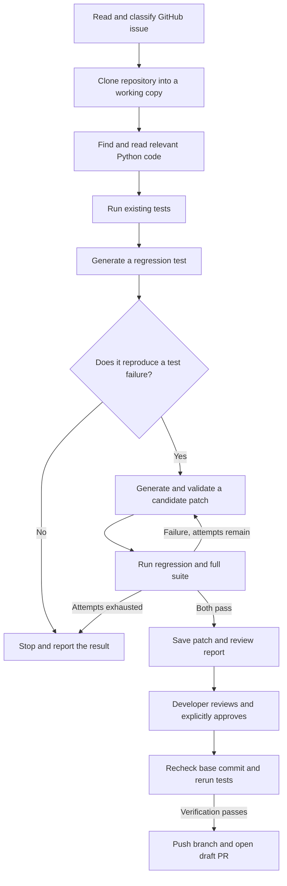

# PatchPilot

**A Python tool that turns a GitHub bug report into a proposed fix, test results, and a patch a developer can review.**

A report such as “the CSV upload crashes when a date is missing” sounds straightforward. Resolving it still takes several steps: find the parser, reproduce the crash, make a change, check the surrounding behavior, and explain the fix to whoever reviews it.

PatchPilot connects those steps. It reads an issue from GitHub, searches the repository, and uses Claude to generate a regression test and a candidate patch. It runs the tests, gives failed attempts back to the model, and records what happened. The developer receives the proposed changes together with the evidence needed to decide whether to use them.

The project focuses on **Python repositories that use pytest**. It is a working prototype with a repeatable offline demo, automated tests, and a historical bug reproduction. Live AI repair performance has not yet been measured.

## A concrete example

The bundled demo contains a small CSV parser. A normal date such as `2024-01-15` works, but an empty date causes `datetime.strptime` to raise a `ValueError`. The issue asks for empty dates to produce `None` instead of stopping the upload.

PatchPilot copies the demo into a separate working directory and runs the existing tests. Two fail. It then creates two regression checks for blank and whitespace-only dates, confirms that they fail on the original code, and applies a patch that checks the date string before parsing it.

After the change, the two regression checks and the three original tests pass. The result is a source diff and a report showing the failures before the change and the passing tests afterward.

| Check | Recorded result |
| --- | --- |
| Original tests before repair | 1 passed, 2 failed |
| New regression tests before repair | 2 failed |
| New regression tests after repair | 2 passed |
| Full discovered suite after repair | 5 passed |

You can inspect the actual [demo report](docs/evidence/demo-report.md), [patch](docs/evidence/demo-patch.diff), and [regression tests](docs/evidence/demo-test_patchpilot_regression.py).

The demo's model responses are predefined so anyone can run it without an API key. Source search, Git patch application, and pytest execution still happen normally. It demonstrates the repair workflow; a live run uses Claude to generate the responses.

## Try the demo

You need **Python 3.10 or newer** and **Git**. Run these commands from the project folder:

```bash
python3 -m venv .venv
source .venv/bin/activate
python -m pip install -r requirements.txt
python cli.py --demo
```

On Windows PowerShell, use `.venv\Scripts\Activate.ps1` to activate the environment.

Dependency installation needs network access unless the packages are already available locally. Once installed, the demo runs offline. The CLI prints the location of `review.html`; open it in a browser to read the test output and proposed diff. The original demo files remain intentionally broken so the example can be repeated.

## What happens during a run



### 1. Read the issue and get the code

The GitHub REST API supplies the issue title and description. Claude classifies the issue, then Git clones the repository into a separate working copy. An optional branch or tag lets you investigate a historical version instead of the current default branch.

### 2. Find the likely source of the problem

PatchPilot extracts identifiers and keywords from the report and ranks Python files using text matches, filenames, and function or class names from Python's abstract syntax tree (AST). It also follows local imports one hop to bring related code into the context.

The context is deliberately bounded. When a large file contains a matching definition, the reader tries to include that definition rather than just the beginning of the file. This search is simple enough to inspect and debug, although it can miss relationships in larger projects.

### 3. Establish a failure before changing the code

The existing suite runs first to establish a baseline. Claude then receives the issue and source context and writes a regression test for the reported behavior.

That test must produce a clean pytest failure before repair can proceed. A passing test, collection error, or timeout does not meet that gate. This reduces the chance of accepting a change without evidence of a problem, but the developer must still check whether the generated test captures the issue correctly.

### 4. Try a patch and use failures as feedback

Claude returns a unified diff. PatchPilot checks that it edits only inspected, existing Python source files. It rejects changes to test files, unrelated paths, symlink targets, file modes, and binary content before Git applies the candidate.

The new regression test and the full discovered pytest suite run after application. If a candidate fails, its diff and failure output become feedback for another attempt. Each attempt starts from the original source; changes do not accumulate between retries. The default is three attempts, with a maximum of five.

### 5. Save the result for review

A successful run saves the source patch, generated test, explanations, captured test output, attempt history, and execution metrics. Unsuccessful runs also produce a report explaining where the workflow stopped.

The `fixed` status means that the regression and discovered suite passed after the patch. It is a result of those checks, rather than a guarantee that every requirement has been met.

### 6. Publish only after approval

Publishing is a separate command. It first shows the target repository and a digest of the review artifacts. After the developer supplies that digest as approval, the publisher checks that the default branch still matches the tested commit, reapplies the reviewed changes, and runs verification again.

Only then does it commit, push a dedicated branch, and open a draft pull request. It does not merge the PR. If the base branch has moved or verification fails, publication stops.

## The tools and their roles

| Tool | Where it fits |
| --- | --- |
| **Python** | Coordinates the workflow, manages files and subprocesses, and records run state. |
| **Anthropic Claude API** | Classifies issues, generates regression tests and patches, and explains proposed changes. |
| **GitHub REST API + requests** | Fetches issue details; an optional token authenticates these requests. |
| **Python AST** | Finds function and class names and local imports to improve source context. |
| **Git** | Clones repositories, checks and applies diffs, and commits/pushes approved changes. |
| **pytest** | Runs baseline, regression, full-suite, and independent benchmark checks. |
| **Docker** | Provides the default test execution option for real repository runs. |
| **GitHub CLI (`gh`)** | Opens a draft pull request after approval and verification. |
| **GitHub Actions** | Defines automated project tests, the offline demo, benchmarks, and a Docker demo job. |
| **python-dotenv** | Loads local credentials and model settings from `.env`. |
| **JSON, Markdown, and HTML** | Store structured results and make the evidence readable in a browser or editor. |

The model implementation is separate from the orchestrator. This lets the offline backend and Claude use the same repository, patching, and testing workflow. Search, execution, and reporting can also be tested without calling an AI service.

## Evidence collected so far

The following results were collected locally on **13 October 2026**. The linked files contain the output rather than just a feature description.

| Check | Result | Evidence |
| --- | --- | --- |
| PatchPilot's automated tests | **31 passed** | [Captured test output](docs/evidence/tests.txt) and [test source](tests/) |
| CSV repair demonstration | **2 original failures before repair; 5 total passes afterward** | [Run report](docs/evidence/demo-report.md) |
| Recorded synthetic benchmark | **3 cases passed their independent holdout tests** | [Benchmark results](docs/evidence/benchmark.json) |
| Historical Click issue | **2 filename-display failures reproduced on version 8.1.3** | [Case study](docs/CASE_STUDY.md) and [captured baseline](docs/click-baseline.json) |

The automated tests cover retries, reproduction gates, source search, import handling, patch restrictions, timeout handling, artifact approval, and blocking publication when re-verification fails.

The synthetic cases cover empty averages, repeated whitespace in slugs, and inclusive bounds. Their reference responses are authored. Independent tests are added only after repair generation, so the backend never sees them. These results establish that the workflow handles several small bug patterns; they do not measure Claude's ability to solve unfamiliar issues.

The Click example reproduces a real historical bug at a recorded commit. No AI-generated repair of that case is claimed. The Docker demo passed on GitHub Actions, alongside project checks on Python 3.10 and 3.12. Live AI repairs and actual draft pull request publishing still need separate verification.

The [validation record](docs/VALIDATION.md) keeps these distinctions together.

## Use Claude on a GitHub issue

Create your local configuration:

```bash
cp .env.example .env
```

Set `ANTHROPIC_API_KEY` in `.env`. `ANTHROPIC_MODEL` defaults to `claude-sonnet-4-5`; select a model available to your account. `GITHUB_TOKEN` is optional for fetching issues. Git authentication is configured separately, and publishing requires GitHub CLI authentication and push access.

With Docker installed and running, build the base test image:

```bash
docker build -t patchpilot-tests:local -f docker/Dockerfile .
python cli.py --repo owner/repository --issue 27 --max-attempts 3
```

Replace the repository and issue with your target. The image contains Python and pytest. If the target needs additional packages, prepare a custom image and select it using `--docker-image IMAGE`. PatchPilot does not install target dependencies automatically.

Docker tests run with networking disabled, a read-only repository mount, a non-root user, and resource limits. Tests that need network services or writes inside the repository may require adaptation. For trusted projects, `--execution local` runs tests in the CLI's environment with your user permissions.

Real runs send issue text, selected source contents, and test output to Anthropic and may incur API charges. The supplied demo and recorded benchmark need no API credentials.

Useful commands:

```bash
python doctor.py                                      # Check basic setup prerequisites
python cli.py --demo --keep-workdir                    # Keep the repaired working copy
python cli.py --repo owner/repo --issue 27 --ref TAG    # Investigate a specific version
python cli.py --help                                   # Show all options
```

The [usage guide](docs/USAGE.md) explains custom images, settings, exit codes, status meanings, and optional token-based cost estimates.

## What a run leaves behind

```text
output/<timestamp>-<run-id>/
├── report.json                    # Structured state, attempts, and metrics
├── report.md                      # Explanation and captured test output
├── review.html                    # Browser-readable report
├── patch.diff                     # Successful candidate, when available
└── test_patchpilot_regression.py   # Generated regression, when available
```

Each run has its own folder, so a later attempt does not overwrite earlier evidence. Start with the HTML report, then check the patch and regression test against the original issue.

To preview publication of a successful real run:

```bash
python publish_pr.py output/RUN_ID
```

After reviewing it, supply the displayed digest:

```bash
python publish_pr.py output/RUN_ID --approve DISPLAYED_DIGEST
```

Publishing directly requires write access to the target repository; automatic fork creation is not implemented. Historical candidates are useful for evaluation, but cannot be published against a different current default-branch commit.

## Reproduce the checks

```bash
python -m pytest               # Project tests; excludes intentionally broken fixtures
python cli.py --demo           # CSV workflow
python benchmark.py            # Three recorded cases with independent holdout checks
python benchmark.py --ai       # Claude on those cases; requires a key and test image
python evaluate.py cases.json  # Evaluate issues you select; see the usage guide
```

Evaluation records outcomes, elapsed time, attempts, and token usage. Optional input/output token prices provide an estimated API cost. A useful evaluation should include unsuccessful attempts and human review of successful candidates, as well as passing tests.

## Finding your way around the code

| Location | Responsibility |
| --- | --- |
| `cli.py` | Arguments, backend selection, artifact output, and exit codes. |
| `agent/orchestrator.py` | Workflow state, reproduction gate, retries, and final verification. |
| `agent/llm_client.py` | Claude integration, authored demo responses, and token tracking. |
| `agent/code_search.py` | Keyword/AST ranking and bounded source context. |
| `agent/github_client.py`, `agent/repo_manager.py` | Issue fetching, repository copies/clones, and cleanup. |
| `agent/patch_generator.py`, `agent/test_runner.py` | Patch validation and local/Docker test execution. |
| `agent/artifacts.py` | JSON, Markdown, and HTML reports. |
| `publish_pr.py` | Approval, pre-publication checks, and draft PR creation. |
| `benchmark.py`, `evaluate.py`, `doctor.py` | Benchmarks, issue evaluation, and setup checks. |
| `tests/`, `demo_repo/`, `benchmarks/` | Project tests, repeatable fixtures, and the historical reproducer. |
| `docker/`, `.github/workflows/` | Test image and CI configuration. |
| `docs/` | Detailed usage, captured evidence, case study, and interview notes. |

## Current limits and next steps

The current version supports existing Python source files and pytest projects. Source context is limited, import expansion follows one hop, and generated tests can misunderstand an issue. The target's pytest configuration also determines what the full suite discovers.

Local mode executes repository code with your user permissions. Docker reduces access and resource use, but is not a complete boundary for hostile code. Use trusted repositories or a disposable environment when assessing unfamiliar code.

The next milestone is to evaluate live AI repairs on real issues, check them against independent tests, and publish human-reviewed results with their time and cost. That evidence will make it clearer where PatchPilot helps and where it still needs a developer's judgment.
